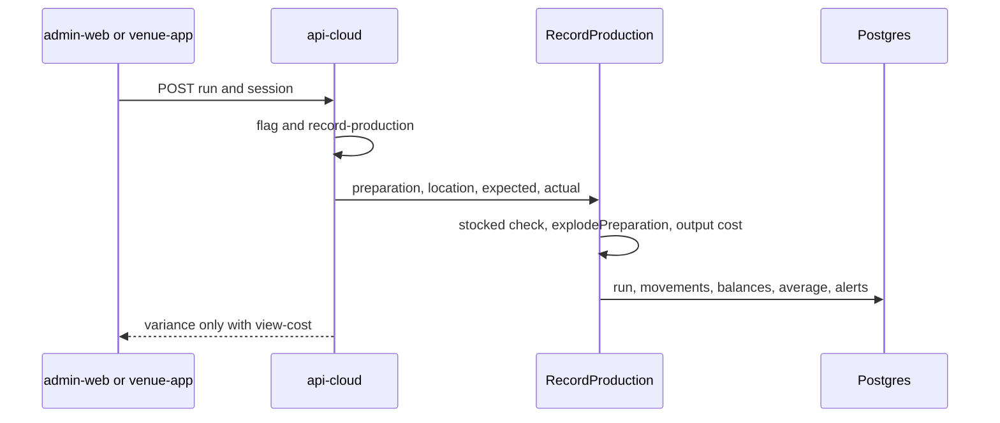

# Design: Production

## Technical Approach

Cloud-only production stays in `contexts/inventory` ([ADR-018](../../../docs/adr/ADR-018-screaming-y-bounded-context.md), [ADR-017](../../../docs/adr/ADR-017-tdd-sobre-hexagonal.md)). `RecordProduction` explodes the preparation and appends movements, yield, and average cost in one PostgreSQL transaction. Host is `api-cloud` with `productionEnabled` (D-37). Hybrid, offline copies, and the `after_sales` drain stay unbuilt. Sales keep the p2-02 collapse and the p2-01 reference snapshot.

## Architecture Decisions

| Decision | Choice | Rejected | Why |
|----------|--------|----------|-----|
| Host | `api-cloud`, flag `productionEnabled` | Node, offline queue, `shared/sync` | D-37. An outage cannot record. |
| Ledger | Writable `production_consumption` (qty < 0) and `production_output` (qty > 0). No edit or delete | New type strings | Constants already exist. |
| Correction | `compensate` writes the opposite sign and `reversesMovementId` once. `reverse` stays sale-only | `sale_return` or delete | The new run references the original. |
| Explosion | `explodePreparation` starts at that recipe. Stocked children stay collapsed | Product `explode` | Sales still deduct the preparation. |
| Batch | Required `outputQuantity`. `floor(line * expected / outputQuantity)` | One unscaled batch | 5000 g on a 5000 g recipe consumes the lines once. |
| Cost | Company `consumed_average` or `standard` (D-26). Standard COP/base unit is per preparation. `nextAverageCost` unchanged | A new purchase formula | On-hand ≤ 0 takes the entry cost; else half-up. |
| Average | Replay uses `nextAverageCost` for `purchase` and positive output. Removal: `roundHalfUp(onHand * average - removed * unitCost, onHand - removed)` | Blending sales or consumption | Output is the real-cost entry (TRD-M4 §1). |
| Output value | Half-up `sum(abs(q) * unitCost) / actual`. Input cost is the location average, including 0 | Reference cost on the run | 24000 COP / 4000 g = 6. Sales keep `ReferenceCostList`. |
| Zero output | No output row. Variance is actual − expected. Inputs still append | Quantity 0 | A burned batch leaves the preparation average. |
| Shortage | Negative ingredients open the existing alert | Reject the run | Spec. |
| Columns | Null `order_line_id` and `role`. Cloud `recipe_version`. `reference` is the run id | `StockLedgerRepository.append` | That path enqueues `after_sales`. Needs p2-03 nullable columns. |
| Auth | `inventory.record-production` to record. `inventory.adjust` or `ConsumeAuthorization` to correct. `inventory.view-cost` for variance. `recipe.edit` for policy | Kitchen adjust | A chief needs a supervisor to correct. |
| Audit | `RecordAuditEvent` on record and correct. Same `runId` is a no-op | `actorId` only | Spec requires the audit. |

## Data Flow

Correction appends opposite movements in that transaction. Apps do not store a run locally.

## File Changes

| File | Action | Description |
|------|--------|-------------|
| `contexts/inventory/domain/stock-ledger.ts` | Modify | Writable types, signs, replay. Leave `nextAverageCost` |
| `contexts/inventory/domain/production.ts` | Create | Run, variance, cost, compensate. Export via `domain/index.ts` |
| `contexts/inventory/domain/recipe-catalog.ts` | Modify | `outputQuantity`, `explodePreparation` |
| `contexts/inventory/application/{record-production,correct-production,configure-production-cost}/` | Create | Three use cases |
| `contexts/inventory/application/ports/production-repository.ts` | Create | One transaction; memory and PostgreSQL contract |
| `contexts/inventory/application/entry-port.ts`, `package.json` | Modify | Additive exports and `#application/...` imports |
| `contexts/inventory/adapters/memory/in-memory-production-repository.ts` | Create | New store |
| `contexts/inventory/adapters/postgres/schema.ts`, `drizzle-production-repository.ts` | Modify / Create | Tables, one transaction |
| `contexts/inventory/adapters/sqlite/schema.ts` | Modify | Table parity only |
| `contexts/platform/domain/permission-catalog.ts` | Modify | `inventory.record-production` |
| `shared/contracts/production.ts`, `index.ts` | Create / Modify | Strict Zod command, policy, run |
| `apps/api-cloud/src/http/production.controller.ts`, `composition/application-module.ts` | Create / Modify | Flag, permission, redaction, wiring |
| `apps/admin-web/src/inventory/inventory-screen.tsx`, `apps/venue-app/src/kitchen/kitchen-screen.tsx` | Modify | Policy, run, variance |

No `local-node`, `shared/sync`, sale-consumption, or purchasing memory edits.

## Interfaces / Contracts

Command: `runId`, `locationId`, `recipeId`, `expectedQuantity`, `actualQuantity`. Policy: `consumed_average` or `standard`, plus `standardUnitCost` per preparation. Producible only when the current cloud version has a stocked line to that recipe and an `outputQuantity`. `production_output` stores that same `recipeId` as its ingredient id, the id `explode` already returns for a stocked preparation.

## Testing Strategy

| Layer | What | Approach |
|-------|------|----------|
| Domain | 6 COP/g, standard 5, burned batch, collapsed child, unchanged purchase average | No Nest |
| Use case | Atomic sauce run; non-stocked reject; duplicate `runId`; chief cannot correct alone | In-memory ports |
| Contract | Memory matches PostgreSQL; failed output rolls back | `production-repository.contract.ts` |
| HTTP | Flag off; waiter denied; variance omitted | Nest bootstrap, no listen |

## Migration / Rollout

Tables `production_runs`, `production_cost_policies`, `preparation_standard_costs`, plus `output_quantity` on published recipes. No movement backfill. Flag off rejects new calls. Rows are compensated, never deleted.

## Threat Matrix

N/A: no routing, shell, subprocess, VCS, or process integration.

## Open Questions

None. Variance is actual minus expected.
