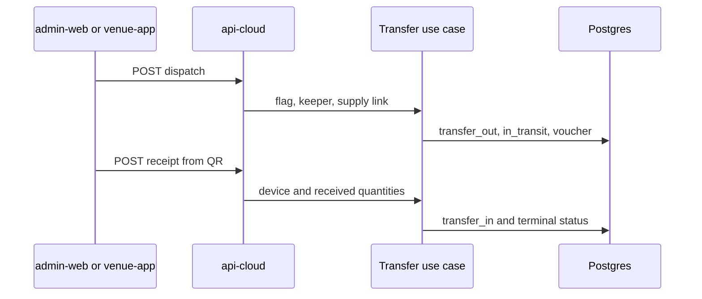

# Design: Warehouses and Transfers

## Technical Approach

Cloud replenishment lives in `contexts/inventory`; supply links live in `contexts/platform` ([ADR-018](../../docs/adr/ADR-018-screaming-y-bounded-context.md), [ADR-017](../../docs/adr/ADR-017-tdd-sobre-hexagonal.md)). Host is `api-cloud` (D-37). Venue warehouses carry a `venueId`; the company general warehouse has `venueId` null. Both are existing `inventory_locations`. One transfer id covers two appended movements. Dispatch enqueues the existing transfer print job. The warehouse node (D-04, ADR-010), PA-44, offline receipt, and `shared/sync` stay hybrid. Node mode, out-of-order halves, and receipt-before-sync are not built.

## Architecture Decisions

| Decision | Choice | Rejected | Why |
|----------|--------|----------|-----|
| Host | `api-cloud`, flag `transfersEnabled` | Node profile, sync, offline queue | D-37. ADR-010 and PA-44 stay hybrid. |
| Supply | `warehouse_supplies` per venue | Any company warehouse | An unlinked warehouse is rejected. |
| States | `requested`; dispatch stamps `dispatched` and `in_transit` together; then `received` or `received_with_differences` | Extra release command | Receipt is legal only from `in_transit`. |
| Halves | `transfer_out` then `transfer_in`, same id | Edit the out; sync reconcile | Append only. No dispatch means the receipt is rejected. |
| Cost | Copy origin `averageCost` onto both `unitCost` values. Out is the full negative dispatch. In is the positive received quantity. `transfer_in` calls `nextAverageCost` with that copied cost. 1000 g at 10 plus 1000 g at 12 is 11. On-hand ≤ 0 takes the receipt cost | A second formula; leaving the destination average unchanged; VAT split | D-27 adds nothing to the origin cost. The spec still updates the destination average with it. |
| Difference | Shortfall stays on the line at that unit cost | Third movement | On-hand grows by the received quantity. |
| Venue | Company out stores the destination `venueId`. Site-to-site out stores the origin venue | Nullable `venue_id` | `stock_movements.venue_id` is `NOT NULL`. |
| Stock | Over origin on-hand is rejected | Negative warehouse stock | Sales may go negative. A transfer may not. |
| Suggestion | `maximum - onHand` when the point is below `minimum` | Alerts, reorder, auto-create | 2.8 owns alerts. No levels, no suggestion. |
| Auth | Request: `inventory.request-replenishment`. Dispatch and exact receipt: keeper on that location, or `inventory.receive-transfer` YES. Differences: YES, or WITH_AUTHORIZATION plus `authorizerId`. Hide `unitCost` without `inventory.view-cost` | New permission | PRD-01 §6.3. Keeper is A on differences. |
| Audit / QR | `RecordAuditEvent` on dispatch and receipt. QR payload is id and lines via existing `EnqueuePrintJob` `transfer`. Registered device session required | Printing edits; offline token | Template exists. An unregistered device records nothing. |
| Write | `TransferRepository`, one PostgreSQL transaction. `transfer_in` updates `average_cost`. Skip `stock_movement_outbox` | `StockLedgerRepository.append` | That path enqueues `after_sales`. Sale columns stay null (p2-03 index). |

## Data Flow

Request stores lines and no movement. Suggest reads levels and on-hand.

## File Changes

| File | Action | Description |
|------|--------|-------------|
| `contexts/inventory/domain/transfer.ts`, `domain/index.ts` | Create / Modify | States, snapshot, suggestion |
| `contexts/inventory/domain/stock-ledger.ts` | Modify | `transfer_out` < 0, `transfer_in` > 0. Average stays purchase-only |
| `contexts/inventory/application/{request,dispatch,receive}-transfer/`, `suggest-replenishment/`, `set-stock-levels/` | Create | Five use cases |
| `contexts/inventory/application/ports/{transfer-repository,warehouse-supply,stock-level-repository,transfer-voucher}.ts` | Create | Store, supply, levels, print |
| `contexts/inventory/application/entry-port.ts`, `package.json` | Modify | Exports and `#application/...` imports |
| `contexts/inventory/adapters/memory/`, `adapters/postgres/` | Create / Modify | Memory store; `transfers`, `transfer_lines`, `stock_levels` |
| `contexts/platform` organization, `declare-warehouse-supply`, postgres schema | Modify / Create | `warehouse_supplies` |
| `shared/contracts/transfer.ts`, `index.ts` | Create / Modify | Strict Zod commands |
| `apps/api-cloud` `transfers.controller.ts`, composition | Create / Modify | Flag, device, permissions |
| `apps/admin-web`, `apps/venue-app` | Modify / Create | Request, dispatch, QR receipt |

No `local-node`, `shared/sync`, printing edit, or purchasing-adapter edit. SQLite is not a transfer runtime.

## Interfaces / Contracts

Request: `transferId`, `destinationLocationId`, `originLocationId`, lines of `ingredientId` and `quantity`. Dispatch adds `actorId` and `deviceId`. Receipt adds `receivedQuantity` and optional `authorizerId`. Levels are scaled base units. Suggestion returns `maximum - onHand`, or nothing.

## Testing Strategy

| Layer | What | Approach |
|-------|------|----------|
| Domain | Order; copied cost; 10 then 9 keeps average; over-dispatch rejected; min 5 max 20 balance 4 suggests 16 | No Nest |
| Use case | Unlinked warehouse rejected; early receipt rejected; duplicate receipt no-op; difference without authorizer stores nothing | In-memory ports |
| Contract | Memory and PostgreSQL match; rollback; `average_cost` unchanged | `transfer-repository.contract.ts` |
| HTTP | Flag off; unregistered device; waiter denied; cost omitted | Nest bootstrap, no listen |

## Migration / Rollout

New tables: `warehouse_supplies`, `transfers`, `transfer_lines`, `stock_levels`. Movements reuse `stock_movements` with null sale columns. No backfill. Flag off rejects new calls. Appended rows stay.

## Open Questions

- [x] "Cost travels" is in this delivery. Origin 12 COP/g into 1000 g at 10 COP/g, receiving 1000 g, sets the destination average to 11 via `nextAverageCost`. 2.10 may read the stored `unitCost` later. It does not own this average.
