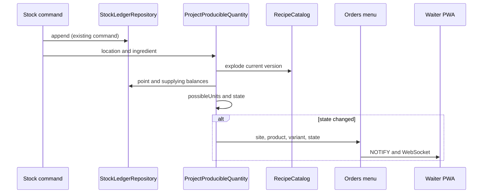

# Design: How Much Can Be Produced

## Technical Approach

Read-only projection over the stock ledger and recipe catalog (roadmap 2.7, PRD-M4 rule 7, TRD-00 §9.3). The rule divides on-hand by the current explosion and names the limiting ingredient. The menu uses point units only. Restock adds supplying-warehouse balances and does not change the menu. No append to `StockLedger`. Cloud only: `apps/api-cloud`, PostgreSQL (D-37). No `shared/contracts`, sync, or `local-node`.

`RecipeCatalog.explode` returns scaled gross quantities (`QUANTITY_SCALE`). A stocked sub-recipe stays one line, keyed by recipe id (p2-04). `StockLedgerRepository.balance` reads `stock_balances` in those integers. A missing row is 0.

## Architecture Decisions

| Decision | Option | Tradeoff | Choice |
|----------|--------|----------|--------|
| Runtime | Cloud and hybrid node | Hybrid needs sync | Cloud only (D-37) |
| Stock source | New balance store | Second ledger drifts | Read `stock_balances`. No append (ADR-018) |
| Menu flag | Flip `orderable` | Blocks a sale (PRD-00 rule 1) | Keep `Menu.isOrderable`. Add `inventoryState` |
| Event | Shared contract plus outbox | Sync is out of scope | In-process port, `NOTIFY`, one WebSocket (TRD-M1) |
| Threshold | Inventory setting | Catalog owns the menu | Venue menu integer, audited, stock-level permission |
| Modifiers | Explode with modifiers | Menu is shown first | Base recipe and variant only |
| Restock freshness | Last-sync timestamp | No sync here | Live cloud balances. No suppliers means restock equals point |
| Caller | Inside each stock use case | Couples consumption to the menu | Composition calls the projector after append |

## Data Flow



Publish rebuilds an ingredient-to-product index from `explode`. A point movement recomputes those products. A warehouse movement refreshes restock units and does not emit.

Point units: `sold_out` at 0; `low_units` at or below a set threshold; otherwise `available`. No threshold means never `low_units`. Emit only on a state change: site, product, variant, state. No cost.

## File Changes

| File | Action | Description |
|------|--------|-------------|
| `contexts/inventory/domain/producible-quantity.ts` | Create | Units, limiting ids, state |
| `contexts/inventory/domain/producible-quantity.test.ts` | Create | Spec cases |
| `contexts/inventory/domain/index.ts` | Modify | Export |
| `contexts/inventory/application/project-producible-quantity/project-producible-quantity.ts` | Create | Project and emit |
| `contexts/inventory/application/project-producible-quantity/project-producible-quantity.test.ts` | Create | In-memory ports |
| `contexts/inventory/application/ports/producible-quantity-repository.ts` | Create | Projection and index |
| `contexts/inventory/application/ports/supplying-locations.ts` | Create | p2-05 location ids |
| `contexts/inventory/application/ports/low-units-threshold.ts` | Create | Catalog threshold |
| `contexts/inventory/application/ports/availability-publisher.ts` | Create | In-process notify |
| `contexts/inventory/application/entry-port.ts` | Modify | Export |
| `contexts/inventory/package.json` | Modify | Imports and exports |
| `contexts/inventory/adapters/postgres/schema.ts` | Modify | Projection tables |
| `contexts/inventory/adapters/postgres/drizzle-producible-quantity-repository.ts` | Create | PostgreSQL |
| `contexts/inventory/adapters/memory/in-memory-producible-quantity-repository.ts` | Create | Test double |
| `contexts/orders/domain/menu.ts` | Modify | `inventoryState` beside `orderable` |
| `contexts/orders/application/apply-menu-availability/apply-menu-availability.ts` | Create | Apply flag, do not block |
| `apps/api-cloud` composition, threshold HTTP, NOTIFY/WebSocket | Modify | After sale, return, waste, publish |

Later purchase, production, and transfer commands call the same projector. SQLite stays untouched.

## Interfaces / Contracts

```ts
type AvailabilityState = "available" | "low_units" | "sold_out";

interface PossibleUnits {
  pointUnits: number;
  replenishmentUnits: number;
  limitingIngredientIds: readonly string[];
  state: AvailabilityState;
}
```

Per line, `floor(max(balance, 0) / quantity)`. Minimum wins. A tie lists every ingredient. Skip `quantity <= 0`. Replenishment sums both balances, then the same floor. `state` ignores replenishment. No recipe keeps manual availability.

## Testing Strategy

| Layer | What to Test | Approach |
|-------|-------------|----------|
| Unit | Minimum, tie, negative, missing row, threshold | Domain Vitest, no Nest (ADR-017) |
| Application | Unrelated ingredient skipped; event only on transition; no append | In-memory ports |
| Contract | Postgres round-trip | api-cloud Vitest |
| HTTP | Sold out still sends; menu shows the flag | api-cloud |

## Migration / Rollout

No backfill. Rows fill on the next stock change or publish. Disabling the projector leaves manual availability (1.1).

## Open Questions

- [x] `production_output` stores the recipe id `explode` already returns. p2-04 design says that id is the movement's ingredient id, so a stocked preparation balance is not left at 0.
