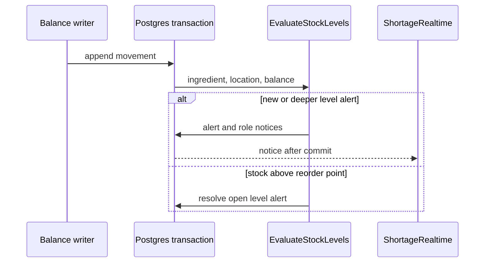
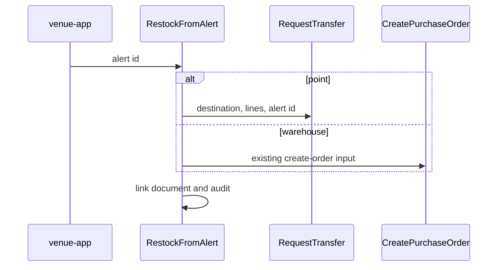

# Design: Early Shortage Alert

## Technical Approach

Alerts stay in `contexts/inventory` ([ADR-018](../../../docs/adr/ADR-018-screaming-y-bounded-context.md)). `api-cloud` and PostgreSQL own every location (D-37). Level checks share the balance transaction. Coverage, dishes, escalation, and suggestions use PgBoss (`apps/api-cloud/src/composition/worker.ts`). Each target role gets a stored notice. WhatsApp, SMS, email, and Web Push stay in 5.1. One tap calls `CreatePurchaseOrder` (p2-03) or `RequestTransfer` (p2-05). No `shared/sync` and no `local-node`. `NegativeStockOpened` (p2-02) stays separate.

Kinds: `level` (`yellow` ≤ reorder, `red` ≤ minimum, `critical` ≤ 0), `coverage`, `dish`.

## Architecture Decisions

| Decision | Choice | Rejected | Why |
|----------|--------|----------|-----|
| Host | `api-cloud`, PgBoss | Node, sync | D-37. Outage stops the site. |
| Levels | Scaled max ≥ reorder ≥ min ≥ 0. Location overrides brand. Sold out is ≤ 0 | Fourth level | TRD-00 §9.4. `QUANTITY_SCALE`. |
| Level row | One open row. Deeper cross raises severity. Resolve only above reorder | Row per cross | No flap. |
| Coverage | N-week weekday-and-slot mean. Skip if history &lt; N | Weekday only | TRD-00 over PRD-M4 rule 10. |
| Dish | Below `DishLevel` via p2-07 units. Name every limiter | Shared threshold | p2-07 has specs, no design. |
| Notice | `RoleNotice` on a cloud socket | Mail, push, `Messaging` | In-product. 5.1 is external. |
| Escalation | Unseen red: kitchen chief, site admin, general manager | Yellow, coverage | Spec names red. |
| One tap | Point: `RequestTransfer`. Warehouse: `CreatePurchaseOrder`. Qty `maximum − stock`, rounded up. Store document id | New document | p2-05 spec and TRD-M4. |
| Suggestions | Pending row from consumption and `leadTimeDays`. Accept activates | Auto-activate | D-32. |
| Audit | Adapter calls `RecordAuditEvent` | Domain imports platform | [ADR-017](../../../docs/adr/ADR-017-tdd-sobre-hexagonal.md). |
| Auth | `inventory.configure-levels`, `inventory.request-replenishment`, venue flag | New codes | PRD-01 §6.3. |

## Data Flow





Coverage reads that slot's movements. Dish evaluation reads p2-07 units after the stock change. Both write the same notice.

## File Changes

| File | Action | Description |
|------|--------|-------------|
| `contexts/inventory/domain/shortage-alert.ts`, `domain/index.ts` | Create / Modify | Kinds, hysteresis, round-up |
| `contexts/inventory/application/{set-stock-levels,evaluate-stock-levels,evaluate-coverage,evaluate-dish-alert,mark-alert-seen,resolve-alert,escalate-alerts,restock-from-alert,propose-stock-levels,accept-stock-levels}/` | Create | Use cases |
| `contexts/inventory/application/ports/{shortage-repository,shortage-audit,transfer-request,producible-units,consumption-history}.ts` | Create | Store and neighbor ports |
| `contexts/inventory/application/entry-port.ts`, `package.json` | Modify | Exports, import map |
| `contexts/inventory/adapters/memory/in-memory-shortage-repository.ts` | Create | In-memory store |
| `contexts/inventory/adapters/postgres/schema.ts`, `drizzle-shortage-repository.ts`, next SQL | Modify / Create | Tables. No SQLite |
| Sale, waste, return, purchase-receipt writers | Modify | Evaluate in `ledger.inTransaction` |
| `shared/contracts/shortage-alerts.ts`, `index.ts` | Create / Modify | Zod notice |
| `apps/api-cloud/src/http/shortage-alerts.controller.ts`, `shortage-realtime.controller.ts` | Create | Flag, socket |
| `apps/api-cloud/src/composition/application-module.ts`, `worker.ts` | Modify | 15-minute jobs |
| `apps/admin-web/src/inventory/inventory-screen.tsx` | Modify | Levels and proposals |
| `apps/venue-app/src/kitchen/kitchen-screen.tsx`, `cash-register/register-screen.tsx` | Modify | Notices, one tap |

## Interfaces / Contracts

```typescript
await ledger.inTransaction(async (tx) => {
  await tx.append(movement);
  await levels.evaluate(tx, { tenantId, locationId, ingredientId });
});
```

`TransferRequest.request` takes `tenantId`, `destinationLocationId`, scaled lines, and `alertId`, and returns `transferId`. `CreatePurchaseOrder` stays unchanged. A notice has `alertId`, `kind`, `severity`, `role`, and `venueId`.

Tables: `stock_level_templates`, `stock_levels`, `dish_levels`, `coverage_settings`, `notification_rules`, `shortage_alerts`, `role_notices`, `suggested_stock_levels`.

## Testing Strategy

| Layer | What | Approach |
|-------|------|----------|
| Domain | Reject bad levels. One critical on a jump. No flap. Round up | No Nest |
| Use case | Shared rollback. Skip thin history. One tap audits | In-memory ports |
| Contract | Memory matches PostgreSQL | `shortage-repository.contract.ts` |
| HTTP | Flag off. Waiter denied. Kitchen sees the notice | Nest, no listen |

`strict_tdd` is false. Order stays inside-out ([ADR-017](../../../docs/adr/ADR-017-tdd-sobre-hexagonal.md)). SQLite is not a runtime.

## Migration / Rollout

New tables only. No alert backfill. `shortage_alerts_enabled` defaults off per venue. Disabling it leaves alerts readable and does not reverse a document. `NegativeStockOpened` rows stay.

## Open Questions

- [x] The actor passes `supplierId`. No preferred supplier is stored.
- [x] One supply link is used. Several links require the actor's warehouse id. Zero links offer a purchase order.
- [x] The spec's red clock is the only escalation clock. `critical` uses that clock. There is no second clock.
- [x] Coverage alerts stay off until the venue stores N, margin, slot, and service end in `coverage_settings`. There is no silent default.
