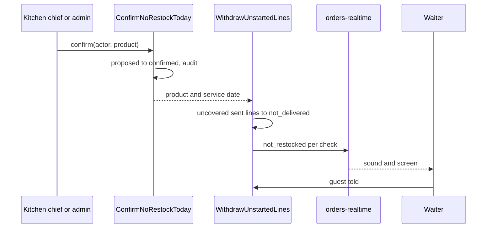

# Design: Not Restocked Today

## Technical Approach

Cloud-only roadmap 2.9 (D-37). Inventory owns `NoRestockToday` (TRD-M4). Orders blocks sends, withdraws uncovered `sent` lines, and notifies the waiter. `apps/api-cloud` calls both entry ports ([ADR-018](../../../docs/adr/ADR-018-screaming-y-bounded-context.md)). Spec: `dish-withdrawal`. A proposal changes nothing else. No `local-node`, SQLite, outbox, `AvailabilityChanged`, or WhatsApp (5.1). Hybrid notice and QR reconnect stay deferred (PA-52). p2-04–p2-08 have no `design.md`; this slice only reads their coverage rules.

## Architecture Decisions

| Decision | Choice | Rejected | Why |
|----------|--------|----------|-----|
| Runtime | PostgreSQL on `api-cloud` | Node, SQLite, sync | D-37. An outage stops the site. |
| Boundary | Inventory port for the mark; orders port for lines. Composition confirms, then withdraws | Inventory imports `Check`; a sync event | Cruiser allows only `entry-port.ts`. |
| Ledger | No new `stock_movements`, no `ReturnStock` or `RecordWaste` | Return or waste on withdrawal | The mark and the line change. The ledger stays in 2.2 and 2.6. The line is not charged. |
| Notice | `not_restocked` on `RealtimeHub` and `ordersRealtimeEvent` | Reuse `line_ready`; WhatsApp | `orders-realtime` drops unknown kinds. Sound and screen stay on that SSE stream. |
| Who | `inventory.confirm-no-restock`: owner, general manager, site admin, kitchen chief. Waiter rejected. Session actor is the person | A second PIN | HU-M4-05, rule 8. PIN is the existing session. |
| Coverage | Point portions &lt; 1, supplying-warehouse portions &lt; 1, and no transfer `dispatched` or `in_transit` | Block on 2.7 sold-out | Sold-out still sends (PRD rule 1). Only this mark blocks (PRD-M1 rule 5). |
| Lines | Oldest `sentAt` first until uncovered portions are out. Started, ready, and delivered stay | `Check.advance` | `sent` is not one rank from `not_delivered`. |
| Expiry | Active on the confirmation `America/Bogota` date. A later date reads `expired`. Removal does not restore lines | Cron; put lines back | No service aggregate. |
| Flag | `noRestockTodayEnabled`. Off skips proposals and rejects confirm. Withdrawn lines stay | Delete rows | Same rollback as sale consumption. |

## Data Flow



Mark: `proposed` → `confirmed` → `removed` or `expired`. `proposed` emits nothing.

Withdrawal: `sent` → `not_delivered` (guest told pending) → guest told recorded. A station may move `in_preparation` or `ready` to `not_delivered` with no movement. `Check.total` skips that state. `TakeOrder.fire` and `ApplyQrOrder` reject only the marked product.

## File Changes

| File | Action | Description |
|------|--------|-------------|
| `contexts/inventory/domain/no-restock-today.ts` | Create | Mark and proposal rule |
| `contexts/inventory/application/{propose,confirm,remove}-no-restock-today/` | Create | Confirm without an actor emits nothing |
| `contexts/inventory/application/ports/{no-restock-repository,portion-supply}.ts` | Create | Store; read-only point, warehouse, inbound transfer |
| `contexts/inventory/application/entry-port.ts` | Modify | Export the three use cases |
| `contexts/inventory/adapters/{memory,postgres}/` | Create | In-memory and RLS Postgres. No SQLite |
| `contexts/inventory/package.json` | Modify | Imports and entry-port export |
| `contexts/orders/domain/check.ts` | Modify | `not_delivered`, withdraw, total, guest told |
| `contexts/orders/application/{withdraw-unstarted-lines,confirm-guest-told,mark-line-undeliverable}/` | Create | Idempotent withdrawal, guest told, cannot finish |
| `contexts/orders/application/{take-order,apply-qr-order}/` | Modify | Reject the marked product; other QR lines proceed |
| `contexts/orders/application/ports/realtime-hub.ts` | Modify | `not_restocked` |
| `contexts/orders/application/entry-port.ts` | Modify | Export the orders use cases |
| `contexts/orders/adapters/postgres/schema.ts` | Modify | Withdrawal columns |
| `shared/contracts/dining-room.ts` | Modify | One SSE kind, not a sync event |
| `contexts/platform/domain/permission-catalog.ts` | Modify | `inventory.confirm-no-restock` |
| `apps/api-cloud/src/http/no-restock.controller.ts` | Create | List, confirm, remove, guest told, cannot finish |
| `apps/api-cloud/src/http/orders-realtime.controller.ts` | Modify | Forward the kind |
| `apps/api-cloud/src/composition/application-module.ts` | Modify | Postgres, flag, `RecordAuditEvent` |
| `apps/venue-app/src/service/{venue-cloud.ts,service-session.tsx}` | Modify | SSE, keep the notice until guest told |

Audit: `inventory.confirm-no-restock` (actor, product, tables), `inventory.remove-no-restock`, `orders.guest-told` (waiter, table, mark). Pending rows stay stored.

## Interfaces / Contracts

```typescript
type NoRestockStatus = "proposed" | "confirmed" | "removed" | "expired";
```

Confirm: `tenantId`, `venueId`, `productId`, `actorId`. Guest told: `checkId`, `lineId`, `actorId`. `PortionSupply` is read-only.

## Testing Strategy

| Layer | What | Approach |
|-------|------|----------|
| Domain | Proposal rule, transitions, total skips `not_delivered`, `advance` stays one rank | No Nest ([ADR-017](../../../docs/adr/ADR-017-tdd-sobre-hexagonal.md)) |
| Use case | No actor, waiter rejected, idempotent confirm, oldest lines, notice stays pending | In-memory ports |
| HTTP | SSE `not_restocked`; confirm permission | Project `api-cloud` |

No E2E. `pnpm test` runs `inventory`, `orders`, and `api-cloud`.

## Migration / Rollout

Table `no_restock_today` (`tenant_id`, RLS) and line columns. No backfill. Flag defaults off.

## Open Questions

- [x] "Today" is the `America/Bogota` calendar date. A service still open after midnight expires the mark when that date changes. There is no later service-close clock.
