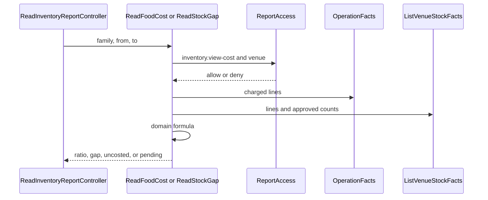

# Design: Inventory Reports

## Technical Approach

Cloud read models for roadmap 2.10 (D-37, PRD-00 §8.3, PRD-M4 §7, PRD-M6 rule 7, TRD-M6 §2 and §7). Two venue reports: food-cost percentage and the theoretical-versus-actual stock gap. `contexts/reporting` owns the formulas and already owns `netSalesCop`. It reads charged sales through `OperationFacts` and stock through a new inventory entry-port read ([ADR-018](../../../docs/adr/ADR-018-screaming-y-bounded-context.md)). api-cloud composes both over PostgreSQL ([ADR-017](../../../docs/adr/ADR-017-tdd-sobre-hexagonal.md)). This change appends no stock movement. With no link there is no report. Waste, value, rotation, producible dishes, alerts, menu engineering, the node day query, and inbox `ProjectFacts` stay out.

## Architecture Decisions

| Decision | Choice | Alternatives | Rationale |
|----------|--------|--------------|-----------|
| Runtime | api-cloud PostgreSQL | Node SQLite; inbox projector | D-37. TRD-M6 §7: no link, no report. |
| Reports | Food cost; stock gap | Rest of §8.3 | Roadmap success is those two. |
| Food cost | `theoreticalCop / netSalesCop` on `[from, to)`. Uncosted products leave both sides and are listed. Zero net sales yields no ratio | Cost a missing recipe as zero | Spec. Reuse `netSalesCop`. |
| Cost source | `abs(quantity) * unitCost` on `sale_consumption`, net of its `sale_return`. `recipeVersion` is on the line | Re-explode the current recipe | A mid-period publish stays on the old line. |
| Stock gap | Per venue, location, ingredient, between two approved counts. Actual = opening + receipts − closing. Theoretical = net sale and production consumption. Waste is its own column. No closing count is `pending` | Write `count_adjustment` | Read models only. |
| Receipts | `purchase`, `transfer_in`, `production_output` | Every positive quantity | Those types increase on-hand. |
| Gap value | `averageCostCop` at closing via `StockLedger.averageCost` | Replay purchases in reporting | Ledger rule stays in inventory. |
| Access | `inventory.view-cost` and home venue. Other venue denied. Waiter gets no figures | Sales controller | PRD-01 §6.3. Sales route would leak cost. |
| Boundary | `ListVenueStockFacts` on the inventory entry port | Reporting SQL | Cruiser forbids another interior. |
| Counts | `ApprovedCountFacts`. No rows means `pending` | Count aggregate here | p2-06 is not applied. |
| Duplicates | One row per movement id | Cloud projector | Ledger already rejects a repeated id. |

## Data Flow

`ListVenueStockFacts` calls `listByVenue` only. It never calls `append`.

## File Changes

| File | Action | Description |
|------|--------|-------------|
| `contexts/reporting/domain/metrics.ts` | Modify | `foodCostRatio`, `stockGap`. |
| `contexts/reporting/application/ports/inventory-facts.ts` | Create | Movement and count facts. |
| `contexts/reporting/application/read-food-cost-report/read-food-cost-report.ts` | Create | Ratio and uncosted products. |
| `contexts/reporting/application/read-stock-gap-report/read-stock-gap-report.ts` | Create | Gap rows or `pending`. |
| `contexts/reporting/application/entry-port.ts`, `package.json` | Modify | Export use cases. Add folder `imports`. |
| `contexts/reporting/adapters/memory/in-memory-inventory-facts.ts` | Create | In-memory facts. |
| `contexts/inventory/application/list-venue-stock-facts/list-venue-stock-facts.ts` | Create | Read lines. Map closing average cost. |
| `contexts/inventory/application/ports/stock-ledger-repository.ts` | Modify | `listByVenue`. |
| `contexts/inventory/application/ports/approved-count-facts.ts` | Create | Approved snapshots. Empty until p2-06. |
| `contexts/inventory/adapters/memory/in-memory-stock-ledger-repository.ts`, `adapters/postgres/drizzle-stock-ledger-repository.ts`, `adapters/sqlite/drizzle-stock-ledger-repository.ts` | Modify | `listByVenue`. SQLite is a port contract, not a node route. |
| `contexts/inventory/application/entry-port.ts`, `package.json` | Modify | Export the list use case and its `imports` pattern. |
| `shared/contracts/reporting.ts` | Modify | Families `food-cost` and `stock-gap`. |
| `apps/api-cloud/src/http/read-inventory-report.controller.ts` | Create | `GET .../venues/:venueId/inventory-reports/:family`. |
| `apps/api-cloud/src/composition/inventory-report-facts.ts`, `src/composition/application-module.ts` | Create / Modify | PostgreSQL facts and `inventory.view-cost`. |

No local-node controller, schema change, or admin-web screen.

## Interfaces / Contracts

Food cost sums lines with `occurredAt` in `[from, to)`. A charged line with no consumption line is uncosted; its net sales leave the denominator.

A gap row is `locationId`, `ingredientId`, `theoreticalQuantity`, `actualQuantity`, `differenceQuantity`, `wasteQuantity`, `averageCostCop`, `differenceCop`. `pending` replaces rows when a location lacks opening and closing approved counts. Count facts are `locationId`, `ingredientId`, `quantity`, `approvedAt`.

## Testing Strategy

| Layer | What to Test | Approach |
|-------|-------------|----------|
| Unit | Ratio, exclusion, pending is not zero, waste column | `metrics.test.ts`, Given / When / Then |
| Application | Other venue, waiter, one row per id, no `append` | In-memory ports |
| HTTP | Missing `inventory.view-cost` | api-cloud Fastify, no listen |
| E2E | Not in this change | No Playwright project |

`strict_tdd` is false. ADR-017 still asks for the failing test first. Context tests stay outside the root Vitest projects.

## Migration / Rollout

No migration. Rollback removes the routes. Stock rows stay.

## Open Questions

- [ ] p2-06 has no design yet. This change only reads approved snapshots and treats a missing closing count as `pending`. Confirm p2-06 exposes that snapshot on the inventory entry port, and that this change still must not write `count_adjustment`.
