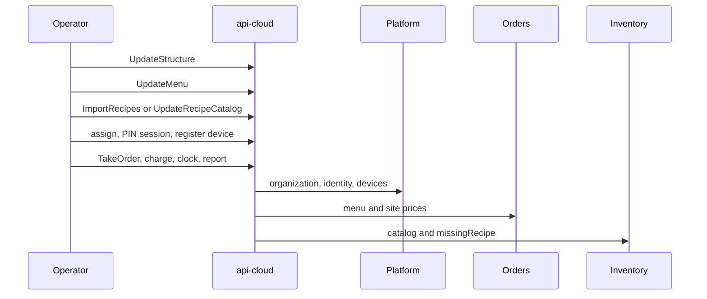

# Design: Six-Site Rollout

## Technical Approach

Roadmap 2.11 and `proposal.md` describe a technical visit, a hardware kit, a data load, role training, and a one-month theoretical-versus-actual measurement. The pilot was cancelled (roadmap 1.14). The product stays a personal project. This change adds no bounded context and no product code ([ADR-018](../../../docs/adr/ADR-018-screaming-y-bounded-context.md)). `specs/site-rollout/spec.md` splits in two: a repeatable checklist over commands the software already runs, and the pilot visit, which stays outside the repository. Venue mode stays `cloud` (D-37). `ViewTheoreticalCost` is plate cost and margin, not a stock-variance report.

## Architecture Decisions

| Option | Tradeoff | Decision |
|--------|----------|----------|
| New `site-rollout` context | Would store visits, kits, and rosters that will not happen | Rejected. Contexts stay `platform`, `orders`, `inventory`, `attendance`, `cash-register`, `invoicing`, `reporting` |
| Go-live aggregate or checklist module | New tables with no operator and no site | Rejected. Evidence is the existing organization, menu, catalog, identity, and operation records |
| Encode the visit and the kit | Invents a client, a site, and a purchase | Rejected. Roadmap 1.14. A dedicated router stays a recommendation (D-36) and is not bought here |
| Pull 2.5–2.10 into this change | Levels, transfers, counts, and the variance report are their own deliveries | Rejected. Do not build them in 2.11 |
| Repeat current cloud commands | A person can load data and each role can run its flow | **Chosen.** No new HTTP route. `openVenue` mode is `cloud` only |

## What Stays in Software

Repeat the existing cloud writes. No new route, schema, or sync payload.

Data load:

- Organization: `UpdateStructure` — `registerCompany`, `addTaxpayer`, `addBrand`, `openVenue`, kitchen stations, cash registers, `addSiteWarehouse`, `addGeneralWarehouse`, `assignStock`.
- Menu and site prices: `UpdateMenu` — `publishProduct`, `publishCombo`, `setVenuePrice`.
- Ingredients and recipes: `UpdateRecipeCatalog` and `ImportRecipes`. A sold product with no recipe is already `RegisterSaleConsumption` with `{ missingRecipe: true }`.
- Staff, roles, and devices: `OperateAuthorization` `assign`, `OperateIdentity` `startPinSession`, `OperateDevices` `issueRegistrationCode` and `registerDevice`.
- Attendance policy: `SetVenueAttendancePolicy`.

Training means each role performs its existing flow once. Do not store a roster.

- Waiter: `TakeOrder` through to the kitchen.
- Cashier: charge the check and issue the invoice on the current cash-register and invoicing paths.
- Kitchen: `ViewStationQueue` and `ChangeLineState`.
- Supervisor: `OperateAuthorization` `request` and `resolve`.
- Site administrator: `GET /tenants/:tenantId/venues/:venueId/reports/:family` for `sales`, `times`, `cash`, and `staff`.
- Anyone on shift: `RecordClockEntry`.

Warehouse-keeper stock moves, levels, supply relations, opening counts, and a theoretical-versus-actual inventory report are not this checklist. They stay in 2.5, 2.6, 2.8, and 2.10.

## What Stays Out of Code

These requirements were the cancelled pilot visit. Do not model them, do not procure hardware, and do not invent a client or a site.

- Technical visit: Wi-Fi coverage, router model, client isolation, dedicated-router decision, printer connections, and an on-site mode choice.
- Hardware kit: node, UPS, printers, 4G modem, print bridge, a test print, and a cash-drawer opening.
- A training attendance book, acceptance of a real full service, and a one-month measurement in three sites.
- A hybrid install and the empty-outbox return to cloud (0.7). Every venue already stays in cloud.

## Data Flow

No visit, printer, or month-long stock report sits on this path. `local-node` is not installed for a site.

## File Changes

| File | Action | Description |
|------|--------|-------------|
| — | None | No product file is created, modified, or deleted |

`apps/api-cloud` and `apps/local-node` keep their composition. Dependency-cruiser rules stay as they are. Contexts keep exposing only `application/entry-port.ts`.

## Interfaces / Contracts

No new types, routes, or Zod schemas. Callers keep the command unions already exported from each context entry port. `OrganizationVenue.mode` remains `cloud`.

## Testing Strategy

`strict_tdd` is false ([ADR-017](../../../docs/adr/ADR-017-tdd-sobre-hexagonal.md)). No new tests, because there is no new behavior. Existing Given / When / Then tests already cover structure, menu, recipe import, `missingRecipe`, devices, authorization, attendance, and site reports.

| Layer | What to Test | Approach |
|-------|-------------|----------|
| Unit | Nothing new | Existing domain tests |
| Integration | Nothing new | Existing `inject` HTTP tests, no `listen` |
| E2E | Not available | No staged site visit |

## Migration / Rollout

No migration. No feature flag. No site goes live. Leaving personal data unloaded is the only rollback. This change deletes nothing.

## Open Questions

- [ ] None. Levels, transfers, counts, and the variance report stay in their own deliveries.
