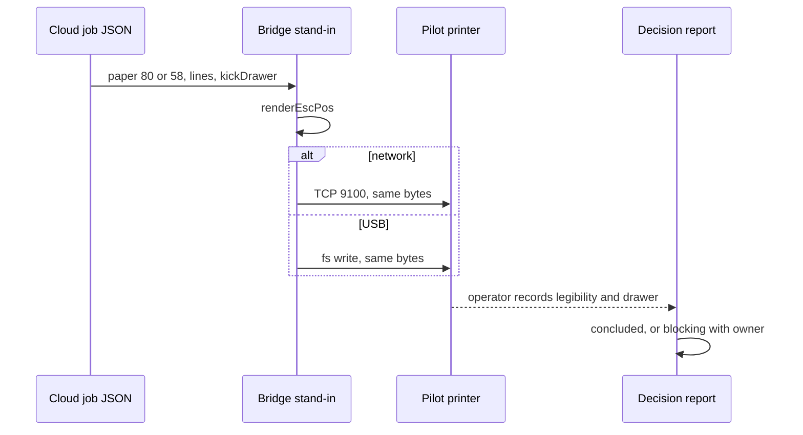

# Design: Risk spikes

Delivery 0.1 is a disposable ESC/POS spike and one decision report (TRD-00 §7, D-37), not delivery 1.6. `local-node` is an empty Nest host. The spike borrows the future `bridge` profile (TRD-00 §5.0: job in, bytes out) and does not edit it. `shared/printing` stays absent. ADR-006 is D-36, with no file under `docs/adr/`.

CI covers the bytes and the report guard only. This workspace has no printer. CI must not mark a visit concluded.

## Architecture Decisions

| Option | Tradeoff | Decision |
|--------|----------|----------|
| `tools/spikes/escpos/` as `.mjs`, tests as `.test.ts` | `tools/` is outside `tsc -b` | **Chosen.** `node tools/spikes/escpos/run-onsite.mjs`. No `tsx` |
| `shared/printing` or a Nest profile in `local-node` | Becomes the 1.6 driver | Rejected |
| Cloud job as a JSON fixture | No HTTP route | **Chosen.** No `api-cloud` change |
| `node:net` and `fs` write; no `child_process` | USB that needs a helper stays blocked | **Chosen.** No shell. A failed open is evidence |
| `concluded` only from operator booleans | CI cannot invent a visit | **Chosen.** Checked-in report is `blocking` |
| Zod for the report | Skeleton forbids Zod under `tools/` | Rejected. Hand-written guard |

## Data Flow

`renderEscPos` ignores transport. Columns: 48 (80 mm) and 32 (58 mm). Drawer pulse after the text: `Uint8Array.of(0x1b, 0x70, 0x00, 0x19, 0xfa)`.

## File Changes

| File | Action | Description |
|------|--------|-------------|
| `tools/spikes/escpos/render-escpos.mjs`, `render-escpos.test.ts` | Create | Widths and drawer pulse. No I/O |
| `tools/spikes/escpos/decision-report.mjs`, `decision-report.test.ts` | Create | Report guard |
| `tools/spikes/escpos/send-bytes.mjs`, `send-bytes.test.ts` | Create | Socket or file write, path refusal |
| `tools/spikes/escpos/run-onsite.mjs` | Create | Job plus evidence. Never sets legibility |
| `tools/spikes/escpos/report.example.json` | Create | `blocking`, owner `pilot-visit`, 1.6 `pending` |
| `tools/spikes/escpos/boundary.test.ts` | Create | `contexts/` and `apps/` do not mention `tools/spikes` |
| `vitest.config.ts` | Modify | Project `spikes`: `tools/spikes/**/*.test.ts` |
| `.dependency-cruiser.cjs` | Modify | Forbid `contexts/` and `apps/` → `tools/spikes/` |

No other edits. `pnpm architecture` scans `contexts`, `apps`, and `shared`.

## Interfaces / Contracts

`CloudPrintJob`: `jobId`, `paperMm` `80 | 58`, `transport` `"network" | "usb"`, `lines`, `kickDrawer: true`.

`DecisionReport`: `spike: "escpos-cash-drawer"`; `setup`; `evidence[]` (`ticketLegible`, `drawerOpened`: `boolean | null`); `network.unregisteredDeviceReachedPrinterPort` and `currentRouterIsolatesPrinters` (`boolean | null`); `dedicatedRouter: "owner-buys"`; `decision`; `consumerDelivery: "1.6"`; `delivery16: "pending" | "unblocked"`; `status: "concluded" | "blocking"`; `owner`; `adr003: "pending-hybrid"`.

`concluded` needs non-null legibility and drawer for every setup printer, both network booleans, and `delivery16: "unblocked"`. Otherwise a closed report is `blocking`: non-empty `owner`, `delivery16: "pending"`. `dedicatedRouter` is `owner-buys` (D-36), with no price. `adr003` is `pending-hybrid`. If the router does not isolate printers, `decision` says buy the dedicated router or use wired printers.

## Testing Strategy

Failing test first ([ADR-017](../../../docs/adr/ADR-017-tdd-sobre-hexagonal.md)). Given / When / Then.

| Layer | What to Test | Approach |
|-------|----------------|----------|
| Unit | Wrap, drawer bytes, guard, example stays `blocking` | Vitest `spikes`. No printer |
| Boundary | No import from `contexts/` or `apps/` | `boundary.test.ts` plus cruiser |
| On-site | Ticket, drawer, guest port, router isolation | Operator evidence or `blocking`. Not a CI pass |

## Threat Matrix

| Boundary | Applicability | Design response | Planned RED tests |
|---|---|---|---|
| Documentation-like paths | Applicable. The operator supplies the USB path. | Safe: refuse before `fs.open`; no `child_process`; exit non-zero; report unchanged. Failure: opening or spawning that path. | One Given/When/Then each: `requirements.txt`, `CMakeLists.txt`, executable markdown (`*.md`, `*.mdx`), `README.sh`. Each: `sendBytes` refuses and spawns nothing |
| Git repository selection | N/A. No `git`. | — | — |
| Commit state | N/A. No commit. | — | — |
| Push state | N/A. No push. | — | — |
| PR commands | N/A. No `gh`. | — | — |

No process is spawned. A host must be a hostname or IPv4 with a numeric port (default 9100), or `send-bytes` refuses before connect.

## Migration / Rollout

No migration. Delete `tools/spikes/escpos/` and revert the Vitest project and the cruiser rule. Delivery 1.6 stays pending until a concluded report exists.

## Deferred

No tasks and no files: local HTTPS (PA-29, ADR-003), locked-phone alerts (PA-30), SQLite peak load, sync, outbox, production node, device registration, print templates, and the print queue.

## Open Questions

- [ ] Printer models and the visit date are unknown. The example stays `blocking` until the visit fills evidence.
- [ ] Until a person is named, `owner` is the role token `pilot-visit`.
