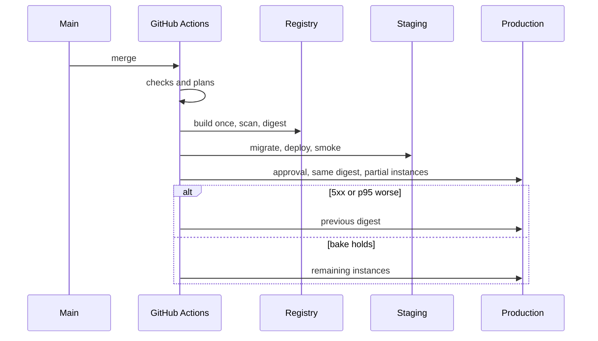

# Design: Infrastructure and continuous delivery

Cloud MVP only (D-37). GitHub Actions (D-45) and Terraform (TRD-01 §4) deploy `apps/api-cloud` on AWS or GCP. Azure is plan-only (D-39). PWAs upload to the cloud static bucket (D-40). Cloudflare is DNS only (TRD-01). Software only (D-36). Adapters hide providers ([ADR-018](../../../docs/adr/ADR-018-screaming-y-bounded-context.md)). Domain and application do not import them.

## Architecture Decisions

| Option | Tradeoff | Decision |
|--------|----------|----------|
| `infra/modules/{aws,gcp,azure}/{network,postgres,service,storage,secrets,registry}` plus `common/dns` | Three copies | **Chosen** (TRD-01 §4.1). Same variables and outputs. CI rejects a mismatch |
| Kubernetes or cloud queues | Extra ops | Rejected (TRD-00 §13). Fargate, Cloud Run, or Container Apps. pg-boss on private PostgreSQL 16 |
| Apply Azure now | Spec lists three live stagings | Rejected (D-39). Plan all three. Apply, backup, and rehearsal: AWS or GCP. `production_cloud` is `aws` or `gcp` |
| Stored cloud keys | Simpler bootstrap | Rejected (D-45). OIDC. One GitHub Environment approval for production |
| Down migration on rollback | Restores the old schema | Rejected. Previous digest only. Infra rollback reapplies the previous git ref |
| Grafana or Sentry bake signal | That content is 0.9 | Rejected. Load-balancer 5xx ratio and p95 |
| Browser E2E | No PWA package yet | Rejected. Smoke: `GET /health` and one `AcceptCloudWrite` |
| Apply from a laptop | Console edits drift | Rejected. `infra/bootstrap` (state, lock, OIDC) is `workflow_dispatch` only |

## Data Flow

`dist/` uploads to the static bucket. Source maps stay private (Sentry release token, the only stored SaaS credential). A private daily job writes the encrypted dump to the other trial cloud; the schedule fails if the object is missing. Monthly rehearsal applies, restores, smokes, and destroys that staging. Drift is a scheduled plan that fails when it is not empty.

Production API min 2, workers min 1, every service has a max. Staging compute may scale to zero. `GET /health` returns `{ "status": "ok" }`. `worker.ts` publishes queue depth and age through `RuntimeMetrics`.

## File Changes

| File | Action | Description |
|------|--------|-------------|
| `infra/modules/{aws,gcp,azure}/{network,postgres,service,storage,secrets,registry}` | Create | Shared contract. Private Postgres 16, production HA, registry, files, static bucket. Workers scale on queue depth and age |
| `infra/modules/common/dns` | Create | Cloudflare records. No dashboards |
| `infra/environments/{staging,production}-{aws,gcp,azure}` | Create | One cloud each. Encrypted remote state, lock, git `ref` pin. Azure is plan-only |
| `infra/bootstrap/{aws,gcp,azure}` | Create | State backend and OIDC trust |
| `docker-compose.yml`, `infra/environments/local/.env.example` | Create | Local Postgres, API, worker. No node |
| `apps/api-cloud/Dockerfile` | Create | Repo-root context, Node 24. Commands `main.ts` and `worker.ts` |
| `.github/workflows/{ci,delivery,drift,backup-check,rehearsal,bootstrap}.yml` | Create | Plan on every `infra/` change. Deliver on main. No Azure apply |
| `tools/infra/{compare-module-outputs,check-postgres-extensions,check-forward-migrations}.mjs`, `tools/delivery/smoke.mjs` | Create | Output parity, extension allowlist, reject `DROP` and `RENAME`, smoke |
| `contexts/platform/application/ports/{file-storage,secrets,runtime-metrics}.ts` plus `.contract.ts` | Create | Abstract classes. Not on `entry-port.ts` |
| `contexts/platform/adapters/memory/in-memory-{file-storage,secrets,runtime-metrics}.ts` | Create | Test doubles |
| `contexts/platform/adapters/{disk,s3,gcs,blob}/`, `secrets-{file,aws,gcp,azure}/`, `metrics-{log,aws,gcp,azure}/` | Create | Per-cloud adapters plus disk, local file, and log. Constructors take the client |
| `contexts/platform/package.json` | Modify | Exports and `#adapters/<folder>/*` imports |
| `apps/api-cloud/src/{health.controller.ts,main.ts,worker.ts}`, `application-module.ts`, `create-application.ts`, `package.json` | Create / Modify | `GET /health`. Listen only in `main.ts`. pg-boss, no job handlers |
| `apps/api-cloud/src/bootstrap.test.ts` and controller tests | Modify | Expect `/health`. `createApplication` still does not listen. Pass memory ports |

Do not edit `apps/local-node`.

## Interfaces / Contracts

`FileStorage`: `put(key, body, contentType)`, `signedReadUrl(key, expiresAt) → URL`. `Secrets`: `read(name) → string`. `RuntimeMetrics`: `publishQueue({ waiting, oldestAgeSeconds })`. Env: `FILE_STORAGE_ADAPTER` (`s3` \| `gcs` \| `blob` \| `disk`), `SECRETS_ADAPTER` (`aws` \| `gcp` \| `azure` \| `file`), `METRICS_ADAPTER` (`aws` \| `gcp` \| `azure` \| `log`), `PORT`, `DATABASE_URL`. Shared outputs: `api_hostname`, `registry_url`, `storage_bucket`, `static_bucket`, `secrets_prefix`, `postgres_endpoint`, `backup_bucket`. Extensions: `pgcrypto`, `pg_trgm`.

## Testing Strategy

| Layer | What to Test | Approach |
|-------|----------------|----------|
| Unit | Contracts, health, SQL checks, output parity | Vitest project `platform`. `node tools/infra/*.mjs` in CI |
| Integration | Cloud adapter and Compose | Stub the SDK client, not the port |
| E2E | Staging | `tools/delivery/smoke.mjs` |

`strict_tdd` stays false ([ADR-017](../../../docs/adr/ADR-017-tdd-sobre-hexagonal.md)).

## Migration / Rollout

No down migrations. `0001` and `0002` stay. pg-boss creates its schema at worker start. Separate accounts.

## Deferred

Not in this design (D-37): sync, SQLite, node image, staged rollout (0.7), node secret file, simulated node, local HTTPS, offline alerts. Node does not serve PWAs (D-40). Grafana, alarms, and Sentry content are 0.9. Factus per-NIT limiter is 1.5. No PWA packages here.

## Open Questions

None.
