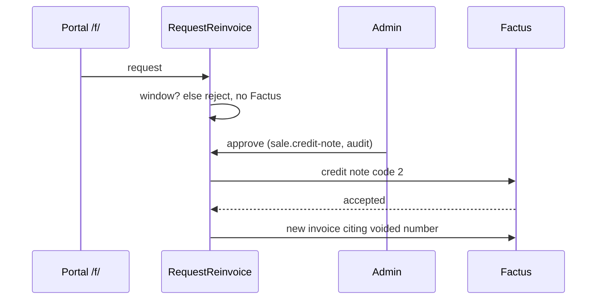

# Design: Invoicing Portal

## Technical Approach

Cloud-only [invoicing portal](specs/invoicing-portal/spec.md) (PRD-M3, TRD-00 8.5, [C4 M3](../../../docs/arquitectura/componentes/c4-m3-facturacion.md), [ADR-017](../../../docs/adr/ADR-017-tdd-sobre-hexagonal.md), [ADR-018](../../../docs/adr/ADR-018-screaming-y-bounded-context.md)). Logic lives in `contexts/invoicing`; `apps/api-cloud` hosts public `portal/*` routes; `apps/customer-portal` renders `/d/:token` and `/f/:link`. D-37: no `local-node`, SQLite, outbox, `shared/sync`, or deferred issuance; hybrid-outage scenarios wait for the hybrid phase.

## Architecture Decisions

| Option | Tradeoff | Decision |
| --- | --- | --- |
| Twilio Verify for codes | Vendor owns the code | **Domain `OneTimeCode`** (6 digits, 10 min, 5 attempts, single use, 60 s resend). Only an HMAC digest is stored (D-48) |
| Port in `platform` for 5.1 reuse | Speculative | **`OneTimeCodeSender` in `contexts/invoicing/application/ports`**, as C4 M3 `Messaging`. 5.1 may lift it to `platform` |
| Twilio/SendGrid SDKs | New deps, mocking | **`fetch` adapter `adapters/twilio`**: SMS via Twilio Messages, email via SendGrid v3, like Factus. Secrets `twilio.account-sid`, `twilio.auth-token`, `twilio.sms-from`, `sendgrid.api-key`, `sendgrid.from-email` via `Secrets` (D-20). Tests use `adapters/memory`. Not Factus, SES/SNS/Azure/GCP (D-47), or Bird |
| `/f/<referenceCode>` | UUIDv7 leaks time; RFC 9562 forbids it as a secret | **`/f/<referenceCode>.<hmac>`** |
| Opaque DB tokens | Lookup per scan | **HMAC-SHA256 `PortalLink`** `{purpose, tenantId, venueId, checkId, exp}`, key `portal.link-key`. `HmacLinkSigner` in `adapters/crypto`; domain stays crypto-free |
| Lookups share 80/min freely | Starves issuance | **`ProviderRateGate.acquire(taxId, at, ceiling = 80)`**; lookups pass `60`, reserving 20 for issuance and credit notes. Per-company acquirer cache (`acquirer_cache`, 30 days) |
| Send full name to the browser | Enumeration | **Server keeps the full lookup** in `portal_lookups`; the browser gets `maskName`/`maskEmail` and a `lookupId` |
| Optional credit-note approval | Spec says "if the company requires" | **Always approved** by a `sale.credit-note` holder (D-42), audited; then `IssueCreditNote`, and only after acceptance a new invoice through the issue worker (D-11) |
| Window in days | D-11 caps it | **`same_day` (default) \| `same_month` \| `off`**, America/Bogota, checked at request and at approval with no provider call |

Code goes to the registered contact of the remembered record, never to a typed one. Deletion also needs a code; it sets `deleted_at` and keeps invoice snapshots.

## Data Flow

```mermaid
sequenceDiagram
  participant C as customer-portal
  participant A as api-cloud portal
  participant U as Invoicing use cases
  participant S as OneTimeCodeSender
  participant H as RealtimeHub
  C->>A: POST d/:token/remembered-code {id}
  A->>U: verify link, limit token+IP
  U->>S: code to masked registered contact
  C->>A: POST .../verify {code}
  U-->>C: remembered data (masked)
  C->>A: POST d/:token/billing-data + consent
  U->>U: validate NIT, email, DANE; store
  U->>H: billing_data_received(checkId)
```



## File Changes

| File | Action | Description |
| --- | --- | --- |
| `contexts/invoicing/domain/portal-link.ts`, `one-time-code.ts`, `billing-data.ts`, `masking.ts`, `reinvoice-window.ts`, `index.ts` | Create / Modify | Value objects, consent; reuse `assertNitCheckDigit` |
| `contexts/invoicing/application/{look-up-portal-buyer,request-remembered-code,verify-remembered-code,record-billing-data,request-data-deletion,get-portal-invoice,request-reinvoice,approve-reinvoice}/` | Create | Use cases |
| `contexts/invoicing/application/ports/{one-time-code-sender,link-signer,code-digest,portal-repository,portal-request-limiter,municipality-catalog,billing-data-notifier}.ts` + `.contract.ts` | Create | Ports and contracts |
| `ports/invoicing-provider.ts`, `adapters/factus/` | Modify | `downloadPdf(number)` |
| `contexts/invoicing/adapters/{memory,twilio,crypto,postgres}/`, `0016_invoicing_portal.sql` | Create | `remembered_buyers`, `consents`, `one_time_codes`, `portal_lookups`, `acquirer_cache`, `portal_submissions`, `reinvoice_requests`, `portal_settings`, `portal_rate_windows`, `dane_municipalities` |
| `contexts/invoicing/package.json`, `entry-port.ts` | Modify | One `#application/<folder>/*` import per folder; exports |
| `contexts/platform/application/ports/provider-rate-gate.ts` and adapters | Modify | `ceiling` |
| `contexts/orders/application/request-check/`, `ports/pre-bill-link.ts`, `realtime-hub.ts` | Modify / Create | Pre-bill QR; `billing_data_received` |
| `shared/contracts/invoicing-portal.ts`, `index.ts`, `dining-room.ts` | Create / Modify | Zod 4 `.strict()` |
| `apps/api-cloud/src/http/portal.controller.ts`, `reinvoice.controller.ts`, composition, tests | Create / Modify | Public and staff routes; unconfigured sender throws |
| `apps/customer-portal/src/` | Create / Modify | Routes, forms |
| `apps/venue-app/src/cash-register/`, `apps/admin-web/src/` | Modify | Flag, conflict choice; window, approvals |

## Interfaces / Contracts

```ts
export abstract class OneTimeCodeSender {
  abstract send(message: { channel: "email" | "sms"; destination: string;
    code: string; companyName: string; expiresInMinutes: number }): Promise<void>;
} // throws OneTimeCodeDeliveryFailed; code never logged
```

Public routes have no session. Unknown or expired link, exhausted limit, or provider failure all return the same shapeless refusal.

## Testing Strategy

| Layer | What to Test | Approach |
| --- | --- | --- |
| Unit | Link, masking, code lifecycle, window | Vitest, Given / When / Then |
| Integration | Lookup ceiling, no cross-tenant data, no provider call outside window | In-memory ports, Postgres contracts |
| Adapter | Twilio/SendGrid request shape | Stubbed `fetch`, no live Twilio |
| HTTP | Portal, approval, venue flag | `api-cloud` |

## Threat Matrix

N/A — no shell, subprocess, VCS/PR automation, or process integration.

## Migration / Rollout

`0016` is additive. `portal_settings.enabled = false` prints pre-bills without QR; `off` disables re-invoicing. Consents and data backing invoices stay.

## Open Questions

- [x] Municipality catalog is the Factus municipalities JSON (DANE), bundled in the app (TRD-00). No separate DIVIPOLA download.
- [x] Spec: make approval mandatory (D-42) and mark hybrid scenarios deferred (D-37).
- [ ] Captcha (infrastructure doc, channel 9) is not in the spec; this change omits it.
