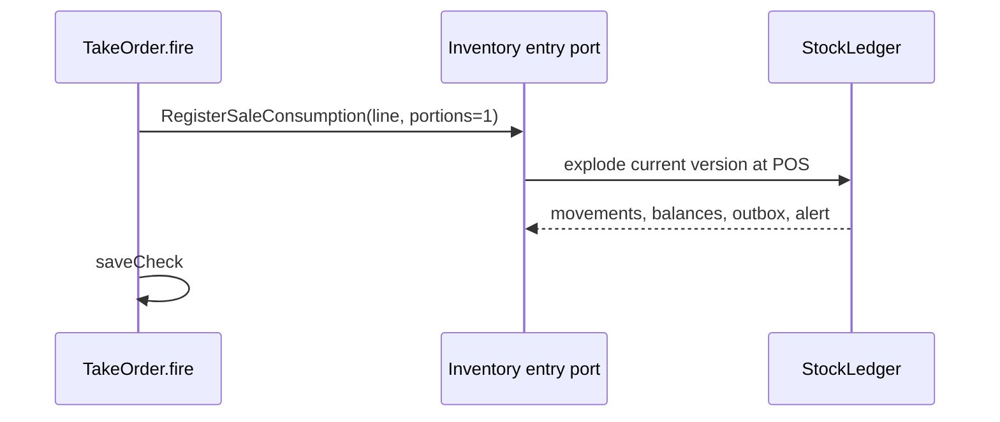

# Design: Sale Consumption

## Technical Approach

Extends the p2-01 `contexts/inventory` entry port ([ADR-018](../../docs/adr/ADR-018-screaming-y-bounded-context.md)) with an append-only ledger and TRD-M4 `RegisterSaleConsumption`, `ReturnStock`, and `RecordWaste`. `orders` calls that port. Explosion and reference cost stay in p2-01. The station is a print route; stock uses the site point-of-sale location (HU-M4-02, rules 1–4; specs `stock-consumption`, `inventory-ledger`).

## Architecture Decisions

| Decision | Choice | Rejected | Why |
|----------|--------|----------|-----|
| Boundary | Inventory `application/entry-port.ts` | Orders SQL or recipe imports; inventory reading `Check` | Cruiser allows that file. `VoidLine`: `held`/`sent` before start; later states after (`Check.advance`). |
| When | `TakeOrder.fire`: in-memory `send`, then the port, then `saveCheck`. One call per line leaving `held` | On charge, or after save | Rule 2. A later `fire` throws `EmptyOrder`, so a saved send cannot retry. |
| Ledger | `StockLedger.append`. Balance is the sum in the same Drizzle transaction | Editable balance; one TX across contexts | Rule 4. One transaction per aggregate (TRD-00). |
| Idempotency | Unique `(tenantId, orderLineId, role)`: `consumption` or `reversal` | Per ingredient | Retry inserts nothing. The other reversal raises `LineReversalConflict`. |
| Shortage | Commit. One open alert per ingredient and location | Block the send | Rule 1. Level alerts and `AvailabilityChanged` are later deliveries. |
| Cost | Snapshot p2-01 reference cost; reversal copies it | Average cost | Average cost is 2.3. Waste does not change unit cost. |
| Owner and sync | Command carries `generation` (reject if stale). Same transaction enqueues `StockMoved`, lane `after_sales` | Read platform tables; build `shared/sync` | Matches platform `StaleGeneration`. p0-02 drains after fiscal, sales, and cash. Apply keys on movement id. |
| Dialects | Memory, PostgreSQL (`SET LOCAL` + `app.tenant_id`), SQLite on `local-node` | PostgreSQL only | Hybrid writes on the node during an outage. Cloud writes only resumed sends. `api-cloud` does not import SQLite. |
| After start | `sent` → `ReturnStock`. Started: `SALE_VOID_AFTER_KITCHEN`, detach, `RecordWaste` | Inventory infers state | That branch returns the check today. `held` never hit the ledger. |
| Rollback | `saleConsumptionEnabled` on `TakeOrder` and `VoidLine` | Delete rows | Off skips the port. |

## Data Flow



Short stock and a missing recipe do not throw (`missingRecipe: true`, no movement). Orders passes `portions: 1` (`StoredLine` has no quantity); "2 burgers" is that input. `sent` calls `ReturnStock` with the stored version. A started line calls `RecordWaste` (reason, actor) and platform `RecordAuditEvent` (`inventory.record-waste`).

## File Changes

p2-01 owns the skeleton. Paths below extend it.

| File | Action | Description |
|------|--------|-------------|
| `contexts/inventory/domain/stock-ledger.ts` | Create | Append, derived balance, one reversal |
| `contexts/inventory/application/{register-sale-consumption,return-stock,record-waste}/` | Create | Three use cases |
| `contexts/inventory/application/ports/{stock-ledger-repository,point-of-sale-directory,operation-generation,stock-alert-publisher}.ts` | Create | Store, POS location, generation, notice, contract |
| `contexts/inventory/application/entry-port.ts` | Modify | Export the three use cases |
| `contexts/inventory/adapters/{memory,postgres,sqlite}/` | Create | In-memory, RLS Postgres, single-tenant SQLite. Postgres and SQLite write the outbox in the same transaction |
| `contexts/inventory/package.json` | Modify | `#application/*` imports and the entry-port export |
| `shared/contracts/stock-movement.ts` | Create | `StockMoved`, `NegativeStockOpened` |
| `contexts/orders/application/take-order/take-order.ts` | Modify | Consume before save when the flag is on |
| `contexts/orders/application/void-line/void-line.ts` | Modify | Return or waste from line state |
| `apps/api-cloud/src/composition/application-module.ts` | Modify | Postgres ledger, flag, publisher |
| `apps/local-node/src/composition/application-module.ts` | Modify | SQLite ledger |
| `vitest.config.ts` | Modify | Project `inventory` |

## Interfaces / Contracts

```typescript
const MOVEMENT_TYPE = {
  PURCHASE: "purchase",
  SALE_CONSUMPTION: "sale_consumption",
  SALE_RETURN: "sale_return",
  WASTE: "waste",
  PRODUCTION_CONSUMPTION: "production_consumption",
  PRODUCTION_OUTPUT: "production_output",
  TRANSFER_OUT: "transfer_out",
  TRANSFER_IN: "transfer_in",
  COUNT_ADJUSTMENT: "count_adjustment",
} as const;
```

Writers: `sale_consumption`, `sale_return`, `waste`. Quantity is p2-01's scaled base-unit integer. Input: `tenantId`, `venueId`, `generation`, `orderLineId`, `productId`, `variantIds`, `modifierIds`, `portions`, `occurredAt`. Result: `{ missingRecipe: boolean }`. Waste adds `actorId` and `reason`.

## Testing Strategy

| Layer | What | Approach |
|-------|------|----------|
| Domain | Negative sum; no edit; one reversal | No Nest ([ADR-017](../../docs/adr/ADR-017-tdd-sobre-hexagonal.md)) |
| Use case | Idempotent send, both voids, missing recipe, one alert | In-memory ports; explosion double |
| Contract | Dialects match; other tenant hidden; failed insert rolls back | `stock-ledger-repository.contract.ts` |
| Orders | One call per new line; flag off skips | Given / When / Then |

## Migration / Rollout

Additive tables: `stock_movements` (insert-only), `stock_balances`, `negative_stock_alerts`, `stock_movement_outbox`, and the POS location. No backfill. Flag off stops new deductions.

## Open Questions

- [ ] Confirm `portions: 1` per line until `StoredLine` grows a quantity.
- [ ] Cruiser: allow `local-node` → inventory SQLite; forbid `api-cloud` → SQLite (first SQLite adapter; ADR-018).
