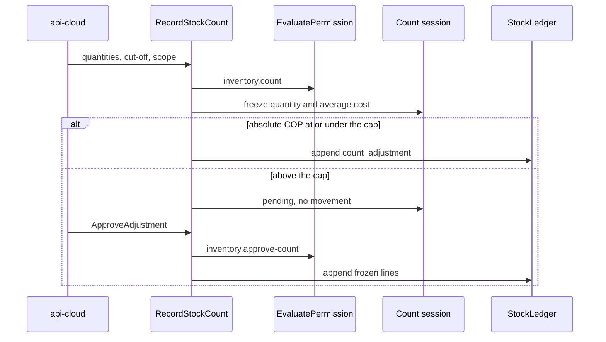

# Design: Waste and Counts

## Technical Approach

Delivery 2.6 is cloud-only (D-37, [ADR-018](../../docs/adr/ADR-018-screaming-y-bounded-context.md)): `api-cloud` and PostgreSQL. Operational waste and counts append to `StockLedger`. `RecordWaste` stays the sale-void path. Movements are never edited or deleted (PRD-M4 rule 4). Caps and the supervisor PIN stay in `EvaluatePermission` (`wasteCop` 30,000 COP, `countAdjustmentCop` 1,000 COP). No `shared/sync`, no `local-node`, no VAT split. PA-42 is not decided.

## Architecture Decisions

| Decision | Choice | Rejected | Why |
|----------|--------|----------|-----|
| Types | Reuse `waste` and `count_adjustment`. A write-off is `waste` with a reason. Allow appending `count_adjustment`. | New type; edited balances | Glossary names both. `change` and `delete` stay `MovementImmutable`. |
| Sale waste | Keep `RecordWaste`. Its reversal id makes `onHandDelta` 0. Operational waste omits it, so the negative quantity changes on-hand. One stocked ingredient. No explosion. | One use case | Sale consumption already deducted the ingredient. |
| Cost | Snapshot `averageCost` now, or at cut-off for a count. Never call `nextAverageCost`. Value is absolute quantity times that cost, whole COP. | Reference cost; VAT split | TRD-M4: these lines do not change average cost. |
| Session | Frozen outside the ledger. At or under the cap, one `count_adjustment` per non-zero line. Above it, wait. Reject writes nothing. Value is the sum of absolute lines. | Recompute later; net of signs | A later purchase must not change variance. D-28 is one adjustment. |
| Population | Full: ingredients moved at the location by the cut-off. Category: that set ∩ `ingredient_classifications`. A missing line rejects the submit. | Whole catalog | The catalog has no category. |
| Authorization | `inventory.record-waste`, `inventory.count`, `inventory.approve-count`. Waste over the cap stores nothing until someone else authorizes. Auto-post at or under the site cap; a site may only lower it (`LimitRaised`). Count self-approval needs the shift flag. | Inventory cap table | p0-05 already stores both limits. |
| Rows | Same `stock_movements` table. `orderLineId` is the document id. `recipeVersion` is 0. No reversal id. | Second ledger | Unique (tenant, document, role, ingredient) retries. Sale rows stay valid. |
| Runtime | HTTP and Postgres on `api-cloud`. Flag `wasteAndCountsEnabled`. | Node, SQLite, sync | D-37. The proposal's offline path is deferred. |
| Blind count | No choice. Variance is still computed after submit. | Show or hide theory | PA-42. |

## Data Flow



`RecordOperationalWaste` has no session. Over `wasteCop`, without another authorizer, it writes nothing. `RecordAuditEvent` follows a stored waste, an auto-posted count, an approval, or a rejection. `StockMoved` reuses lane `after_sales`.

## File Changes

New folders only. Do not edit `record-waste`, purchasing, or p2-03, p2-04, and p2-05. `entry-port.ts` only gains exports. No `local-node` and no SQLite.

| File | Action | Description |
|------|--------|-------------|
| `contexts/inventory/domain/stock-ledger.ts` | Modify | Writable `count_adjustment`; either sign, reject 0; `balanceUntil`, `averageCostUntil` |
| `contexts/inventory/domain/operational-waste.ts`, `stock-count.ts` | Create | Reasons; scope, frozen variance, absolute COP |
| `contexts/inventory/application/{record-operational-waste,record-stock-count,approve-adjustment,set-ingredient-category}/` | Create | Waste, submit, approve or reject, classify |
| `contexts/inventory/application/ports/stock-ledger-repository.ts`, `stock-movement-queue.ts` | Modify | Roles `operational_waste` and `count_adjustment` |
| `contexts/inventory/application/ports/stock-count-repository.ts`, `ingredient-classification.ts` | Create | Session and category ports |
| `contexts/inventory/application/entry-port.ts`, `package.json` | Modify | Exports and `#application/...` imports |
| `contexts/inventory/adapters/memory/`, `adapters/postgres/` including `schema.ts` | Create | Sessions, lines, classifications |
| `contexts/platform/application/evaluate-permission/evaluate-permission.ts` | Modify | Optional `selfAuthorizationAttempt`, default false |
| `shared/contracts/stock-movement.ts` | Modify | Allow the two roles on `StockMoved` |
| `apps/api-cloud/src/http/stock-operations.controller.ts`, `composition/application-module.ts` | Create / Modify | Routes, Postgres wiring, flag |

## Interfaces / Contracts

```typescript
export const CONSUMPTION_ROLE = {
  CONSUMPTION: "consumption",
  REVERSAL: "reversal",
  OPERATIONAL_WASTE: "operational_waste",
  COUNT_ADJUSTMENT: "count_adjustment",
} as const;
```

`count_adjustment` is a non-zero base-unit integer (`QUANTITY_SCALE`). `waste` stays negative. `occurredAt` is ISO-8601. A counted unit uses the catalog factor, then the scale. On `StockMoved`, `orderLineId` is the document id and `recipeVersion` is 0. Reasons: `expired`, `damaged`, `preparation_error`, `other` (note required).

## Testing Strategy

| Layer | What | Approach |
|-------|------|----------|
| Domain | Signs, immutability, cut-off, missing line, reasons | No Nest ([ADR-017](../../docs/adr/ADR-017-tdd-sobre-hexagonal.md)) |
| Use case | Caps, self-approval, reject leaves stock | In-memory ports |
| Contract | Postgres append; other tenant hidden | No SQLite |
| HTTP | Flag off skips routes | `api-cloud` Vitest project |

## Migration / Rollout

New Postgres tables only. No backfill. The flag defaults off. Stored movements stay.

## Open Questions

- [ ] PA-42: whether a count hides the theoretical quantity. This design does not choose.
